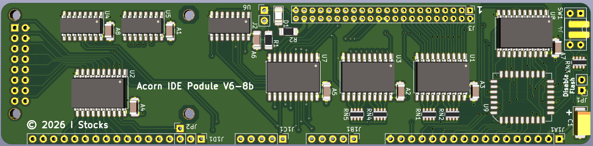

# IDE podule 8 bit

8-bit IDE podule for Acorn machines (A3000, A3010, A3020 & A4000). It also includes a header for a CH376 USB module compatible with USBFS.

Compatibe with the interface number 3 version of ZIDEFS - https://www.zeridajh.org/software/zidefs/index.html

Flash can be programmed in-situ, so the chip can be soldered on-board without a socket. Programming software will be added later. 

More details on USBFS and a stand-alone USBFS podule here - https://codeberg.org/IanS/ch376_podule

The flash chip (SST39SF010) can be used in its entirety as a single 128K block with both switches turned on. It make more sense to treat it as four 32K chunks to allow the alternative version of the ZIDEFS software to be used. Using the different versions (ZIDEFS/IDEFS/SIDEFS) allows multiple podules to be installed in a single machine. Note that the ZIDEFS partitioning, deviceid and formatting tools only work with the ZIDEFS version. Multiple podules is only likely to be possible on an A3000 using both the internal and external podules connectors.

PCB

